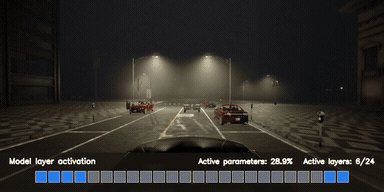
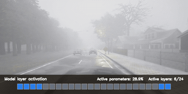
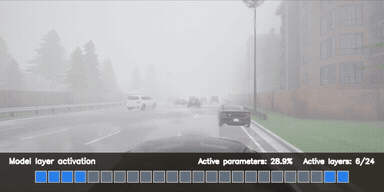
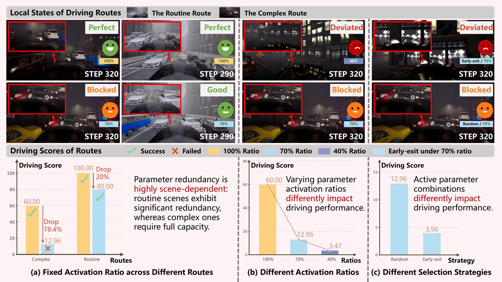
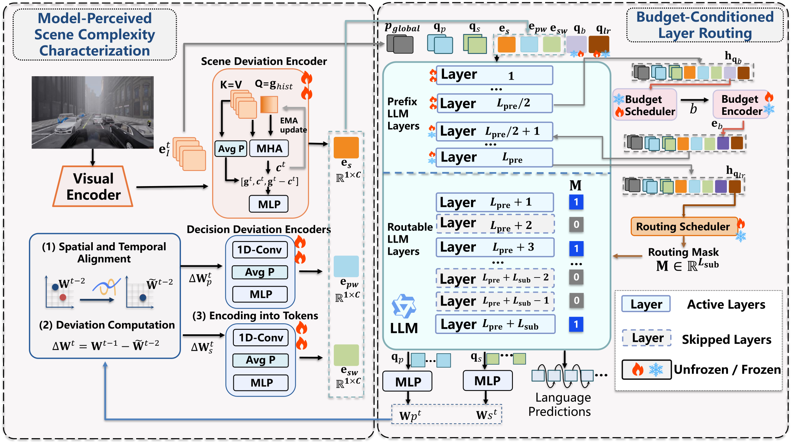

# Scene-Adaptive VLA: Efficient Autonomous Driving via Dynamic Layer Routing[NeurIPS 2026]

<p align="center">
  Yujia Yang · Quan Yuan<sup>*</sup> · Jiawei Fan · Yang Li · Tiange Fu · Xiaoyuan Fu · Guiyang Luo · Jinglin Li
</p>

<p align="center">
  State Key Laboratory of Networking and Switching Technology,<br>
  Beijing University of Posts and Telecommunications
</p>

This repository provides the official implementation of **Scene-Adaptive VLA**,
accepted at **NeurIPS 2026**. It reduces average inference FLOPs by **53.5%** and inference
latency by **49.0%**, with negligible degradation in driving and language
capabilities.

<p align="center">
  <a href="readme-source/video1.mp4"></a>
  <a href="readme-source/video2.mp4"></a>
  <a href="readme-source/video3.mp4"></a>
</p>

## Contents

1. [Overview](#overview)
2. [News](#news)
3. [Environment setup](#environment-setup)
4. [Bench2Drive evaluation](#bench2drive-evaluation)
5. [Citation](#citation)

## Overview

Scene-Adaptive VLA is an efficient VLA framework for autonomous driving that
estimates model-perceived scene complexity in real time and accordingly adjusts
the active parameters for each frame, reducing parameter redundancy and
computational overhead while preserving driving performance.

<p align="center">
  
</p>

As illustrated in Figure, this scene-adaptive computation is enabled by two components: scene complexity is first characterized from temporal visual changes and decision deviations; conditioned on this characterization, a budget-conditioned layer-routing mechanism determines the active parameter ratio and selects the decoder layers to execute. In this way, the model adapts its computation to driving scenes of varying complexity.
<p align="center">
  
</p>

## News

- ✅ Release inference code and checkpoints
- ⬜ Release training code

## Environment setup

The environment targets Linux with Python 3.8, CARLA 0.9.15, PyTorch 2.2.0,
and CUDA 12.1. The default training configurations use two NVIDIA GPUs.

### 1. Clone the repository and install CARLA

```bash
git clone https://github.com/yang-luvu/Scene-Adaptive-VLA.git
cd Scene-Adaptive-VLA

chmod +x setup_carla.sh
./setup_carla.sh /absolute/path/to/CARLA_0.9.15
```

The installer downloads CARLA 0.9.15 and its additional maps. Reserve about
20 GB for the downloaded archive before extraction.

### 2. Create the Conda environment

The default environment contains the direct dependencies required for training
and Bench2Drive evaluation. Its name is `simlingo-SA`.

```bash
conda env create -f environment.yaml
conda activate simlingo-SA

pip install flash-attn==2.7.0.post2 --no-build-isolation
```

### 3. Configure local paths

For training, configure CARLA and the SimLingo dataset root:

```bash
python tools/setup_paths.py \
  --carla-path /absolute/path/to/CARLA_0.9.15 \
  --data-path /absolute/path/to/simlingo-dataset
```

For Bench2Drive evaluation only, the dataset path can be omitted:

```bash
python tools/setup_paths.py \
  --carla-path /absolute/path/to/CARLA_0.9.15
```

The generated `configs/paths.local.yaml` is machine-specific.

## Bench2Drive evaluation

### Prepare the checkpoint

Download the released [`model.zip`](https://huggingface.co/yangluvu/scene-adaptive-VLA)
and extract it into the project root:

```bash
unzip /path/to/model.zip -d .
```

Closed-loop evaluation uses
`configs/stage2_eval.yaml`. Set `eval.checkpoint`
to the Stage 2 checkpoint, then launch the full evaluation:

```bash
python start_eval_simlingo_adaption.py \
  --eval-config configs/stage2_eval.yaml \
  --gpu 0
```

After all 220 routes finish, the evaluation results are stored under the
`eval.output_path` configured in `configs/stage2_eval.yaml`. Compute the
closed-loop metrics with:

```bash
output_path=eval_results/stage2_eval
python Bench2Drive/tools/closed_loop_eval_metrics.py \
  --eval-root "$output_path/simlingo/bench2drive/5/smart_assigner"
```


## Citation

We thank the authors of 
[SimLingo](https://github.com/renzka/simlingo) and
[AdaLLaVA](https://github.com/zhuoyan-xu/AdaLLaVA) for their valuable contributions and open-source code. If you find Scene-Adaptive VLA useful, please cite the following works:

```bibtex
@inproceedings{yang2026sceneadaptivevla,
  title     = {Scene-Adaptive VLA: Efficient Autonomous Driving via Dynamic Layer Routing},
  author    = {Yang, Yujia and Yuan, Quan and Fan, Jiawei and Li, Yang and Fu, Tiange and Fu, Xiaoyuan and Luo, Guiyang and Li, Jinglin},
  journal = {arXiv preprint arXiv:2610.24590},
  year      = {2026}
}

@inproceedings{renz2025simlingo,
  title={Simlingo: Vision-only closed-loop autonomous driving with language-action alignment},
  author={Renz, Katrin and Chen, Long and Arani, Elahe and Sinavski, Oleg},
  booktitle={Proceedings of the Computer Vision and Pattern Recognition Conference},
  pages={11993--12003},
  year={2025}
}

@inproceedings{xu2025learning,
  title={Learning to Inference Adaptively for Multimodal Large Language Models},
  author={Xu, Zhuoyan and Nguyen, Khoi Duc and Mukherjee, Preeti and Bagchi, Saurabh and Chaterji, Somali and Liang, Yingyu and Li, Yin},
  booktitle={Proceedings of the IEEE/CVF International Conference on Computer Vision},
  pages={3552--3563},
  year={2025}
}
```
